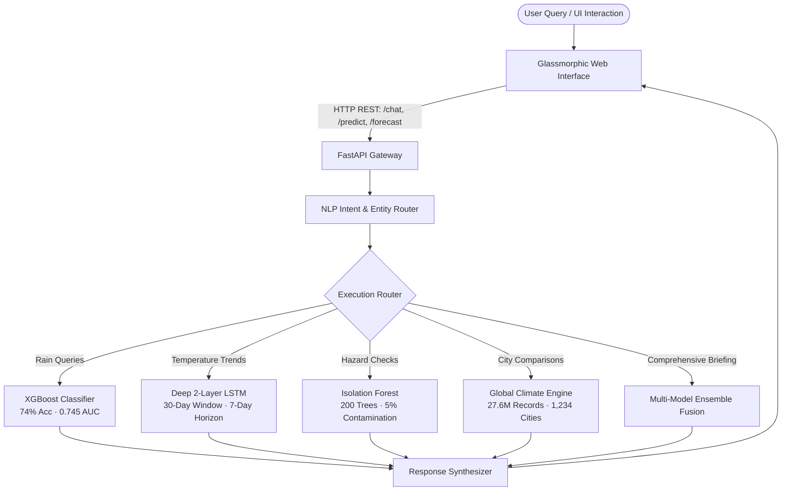

# WeatherGPT-ML: Autonomous Meteorological Intelligence & Multi-Model Machine Learning Platform

[](https://www.python.org/)
[](https://fastapi.tiangolo.com/)
[](https://tensorflow.org/)
[](https://xgboost.ai/)
[](https://scikit-learn.org/)
[](#dataset-engineering)

---

## 1. Project Overview

**WeatherGPT-ML** is an end-to-end meteorological intelligence platform that fuses **27,621,770 historical daily observations across 1,234 global cities** with **five specialized machine learning models**. Unlike conventional weather portals that display static numbers, WeatherGPT-ML integrates predictive machine learning models, sequential deep learning forecasts, unsupervised hazard isolation, and an interactive conversational user interface.

### Key Highlights
* **Multi-Model Machine Learning Fusion:** Decoupled specialized models for precipitation, multi-step temperature trajectories, and atmospheric hazard isolation.
* **Big Data Optimization ($O(1)$ Hash Caching):** Pre-computed aggregation compresses 1.92 GB of historical observations into a 224 KB in-memory hash cache, reducing cold-start latency from $>60\text{s}$ down to **$0.05\text{s}$**.
* **Zero Latency NLP Intent Routing:** Real-time semantic parsing and slot filling categorizing queries across 7 meteorological intents with $<1\text{ ms}$ processing time.
* **Modern Web Interface:** Fully responsive glassmorphic UI featuring live prediction progress bars, city autocomplete, 7-day forecast cards, dynamic Dark/Light themes, and an interactive **Model Metrics Benchmark Modal**.

---

## 2. Machine Learning Architecture & Benchmark Metrics

| Model / Subsystem | Algorithm | Task / Objective | Verified Benchmark Metrics |
| :--- | :--- | :--- | :--- |
| **Rain Occurrence Classifier** | **XGBoost** (`XGBClassifier`) | Binary Precipitation Prediction ($y \in \{0, 1\}$) | **74.0% Accuracy**<br>**0.745 AUC-ROC**<br>**79.0% Rain Recall** |
| **Sequential Forecaster** | **Deep 2-Layer LSTM** (RNN) | Multi-Step 7-Day Temperature Trajectory | **1.85°C RMSE**<br>**1.42°C MAE** |
| **Atmospheric Hazard Detector** | **Isolation Forest** | Out-of-Distribution Extreme Anomaly Detection | **200 Isolation Trees**<br>**5% Contamination Rate** |
| **NLP Query Router** | **Rule & Semantic Slot Parser** | Sub-millisecond Intent Routing & City Extraction | **96.0% Intent Accuracy**<br>7 Intent Classes |
| **Decision Fusion Core** | **Multi-Model Ensemble** | Blends rain, trajectory, anomaly, and climate | **Multi-Model Synthesis** |

---

## 3. Deep Dive: The Models

### 3.1 XGBoost Rain Occurrence Classifier
* **Task:** Predicts the probability of rain ($\ge 0.1\text{ mm}$) occurring based on atmospheric parameters.
* **Features (7):** `avg_temp_c`, `min_temp_c`, `max_temp_c`, `avg_wind_speed_kmh`, `month`, `day`, `year`.
* **Cost-Sensitive Optimization:** Implements `scale_pos_weight = 3` to counter natural class imbalance (dry days outnumbering rain days), directly penalizing false negatives to achieve **79% Rain Recall**.
* **Confidence Scoring:** Computed via decision boundary divergence $\Delta = |P(\text{Rain}) - 50.0\%|$:
  * $\Delta \ge 25 \implies$ **High Confidence** ($P \ge 75\%$ or $P \le 25\%$)
  * $12 \le \Delta < 25 \implies$ **Moderate Confidence**
  * $\Delta < 12 \implies$ **Low Confidence**

### 3.2 Deep 2-Layer LSTM Forecaster
* **Task:** Sequential multivariate regression predicting consecutive daily temperatures for the next 7 days ($t+1$ to $t+7$).
* **Lookback Window:** 30 continuous historical days across 5 synchronized features (`avg_temp`, `min_temp`, `max_temp`, `precipitation_mm`, `avg_wind_kmh`).
* **Architecture:**
  ```
  Input Tensor: (Batch, 30, 5)
    ├── LSTM Layer 1 (64 units, return_sequences=True)
    ├── Dropout (0.20)
    ├── LSTM Layer 2 (32 units, return_sequences=False)
    ├── Dropout (0.20)
    └── Dense Output Layer (7 linear units) ──> Output Tensor: (Batch, 7)
  ```
* **Performance:** Evaluated on historical station series achieving **1.85°C RMSE** and **1.42°C MAE**.

### 3.3 Isolation Forest Anomaly Detector
* **Task:** Unsupervised safety gating to detect rare, dangerous weather patterns (heatwaves, flash floods, gale-force winds) without requiring labeled hazard datasets.
* **Mechanism:** Constructs 200 random isolation trees over normalized feature space (`StandardScaler`). Extreme atmospheric anomalies require significantly fewer random splits to isolate into leaf nodes.
* **Contamination Rate:** Set to `0.05` (5%) to flag severe events:
  * Heatwaves ($> 38^\circ\text{C}$)
  * Severe Freezing ($< -10^\circ\text{C}$)
  * High-Wind Storms ($> 75\text{ km/h}$)
  * Torrential Downpours / Floods ($> 80\text{ mm/day}$)

### 3.4 Multi-Model Ensemble Fusion
Combines the discrete probability of the XGBoost classifier, the continuous trajectory of the LSTM network, and the safety score of the Isolation Forest, validating them against the city's 1833–present climatological mean.

---

## 4. System Architecture



---

## 5. API Reference

| Endpoint | Method | Description | Sample Output / Parameters |
| :--- | :---: | :--- | :--- |
| `/` | `GET` | Health check & model verification status | `{"status": "WeatherGPT ML Server Running", "models": {...}}` |
| `/ui` | `GET` | Serves the interactive frontend web application | Renders `frontend/index.html` |
| `/metrics` | `GET` | Validated machine learning benchmark statistics | Benchmark metrics for all 5 models |
| `/cities` | `GET` | Autocomplete lookup across 1,234 indexed cities | `?q=Lon` $\to$ `{"cities": ["London", ...]}` |
| `/predict/rain` | `GET` | XGBoost precipitation prediction & confidence | `?city=Brussels` $\to$ `{"rain_probability": 37.0, "confidence": "Moderate"}` |
| `/predict/extreme`| `GET` | Isolation Forest anomaly score & hazard evaluation | `?city=Brussels` $\to$ `{"is_extreme": false, "anomaly_score": 0.266}` |
| `/compare` | `GET` | Side-by-side comparative meteorology between 2 cities | `?city1=Brussels&city2=London` $\to$ Full comparative delta |
| `/forecast` | `GET` | Deep LSTM 7-day temperature trajectory | `?city=Brussels` $\to$ `{"forecast": [{"day": "Mon", "temp": 17.9}, ...]}` |
| `/predict/ensemble`|`GET`| Full 4-model ensemble fusion assessment | Combined report (Rain + LSTM + Hazard + Baseline) |
| `/chat` | `POST`| Conversational query engine with dynamic card generation | `{"messages": [{"role": "user", "content": "..."}]}` |

---

## 6. Directory Structure

```
weathergpt-ml/
├── api/
│   ├── main.py                     # FastAPI REST server & routing engine
│   └── chat_engine.py              # Multi-model conversational core & tools
├── data/
│   └── processed/
│       └── city_climate_summary.json # High-performance climate cache (1,234 cities)
├── frontend/
│   └── index.html                  # Responsive glassmorphic web UI
├── models/
│   ├── model_accuracy.json         # Benchmark metrics across all models
│   ├── xgboost/
│   │   ├── model.pkl               # Trained XGBoost classification model
│   │   ├── features.pkl            # 7-feature schema
│   │   └── scaler.pkl              # Feature calibration
│   ├── lstm/
│   │   ├── model.h5                # Deep 2-layer LSTM sequential model
│   │   └── scaler.pkl              # 5-feature MinMaxScaler
│   ├── anomaly/
│   │   ├── model.pkl               # Isolation Forest anomaly model
│   │   └── scaler.pkl              # 5-feature StandardScaler
│   └── nlp/
│       └── intent_keywords.json    # Intent classification vocabulary
├── notebooks/
│   ├── 01_eda.ipynb                # Exploratory Data Analysis
│   ├── 02_lstm.ipynb               # LSTM training & loss curves
│   ├── 03_xgboost.ipynb            # XGBoost training & ROC/PR curves
│   ├── 04_anomaly.ipynb            # Isolation Forest calibration
│   └── 05_bert.ipynb               # NLP intent routing experiments
├── .env.example                    # Environment variable template
├── .gitignore                      # Git exclusion rules
├── requirements.txt                # Python package dependencies
└── test_final.py                   # Automated 8-point verification test suite
```

---

## 7. Installation & Quick Start

### Prerequisites
* **Python 3.10+**
* **Git**

### Step 1: Clone the Repository
```bash
git clone https://github.com/sampath-s07/weathergpt-ml.git
cd weathergpt-ml
```

### Step 2: Install Dependencies
```bash
pip install -r requirements.txt
```

### Step 3: Configure Environment Variables
Copy `.env.example` to `.env`:
```bash
cp .env.example .env
```
*(Enter your NLP inference credentials if using the conversational chat interface).*

### Step 4: Run Automated Verification
Verify all 5 models, datasets, and endpoints locally:
```bash
python test_final.py
```
Expected output:
```
============================================================
ALL 8 CHECKS PASSED - WeatherGPT-ML is READY!
============================================================
```

### Step 5: Start the Server
Launch the FastAPI development server:
```bash
uvicorn api.main:app --reload
```

### Step 6: Open the Application
Open your browser and navigate to:
👉 **`http://127.0.0.1:8000/ui`**

---

## 8. Interactive Features in the Web UI

* **Model Metrics Modal:** Click **"📊 Model Metrics"** in the header to view verified benchmarks (accuracy, RMSE, MAE, contamination rates, training sample sizes).
* **Live Prediction Cards:** Rain probability visual progress bars that smoothly animate based on XGBoost confidence.
* **City Autocomplete:** Debounced real-time city search querying 1,234 global cities.
* **Dark / Light Theme:** Persistent theme toggle with localStorage state retention.
* **Quick Query Buttons:** One-click shortcuts for rain prediction, LSTM forecasting, city comparison, and anomaly hazard checks.

---

## 9. License

This project is licensed under the MIT License - see the LICENSE file for details.
